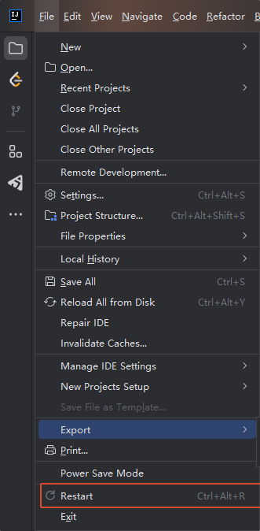
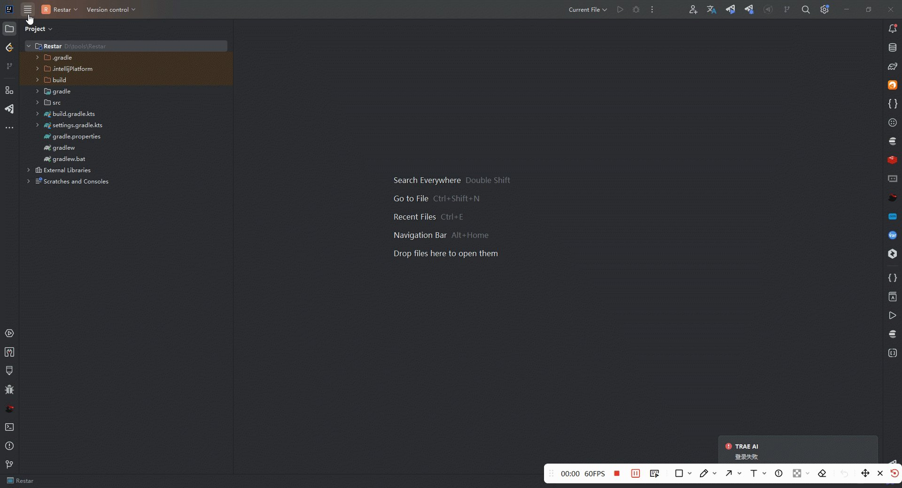

# Restart

[](https://plugins.jetbrains.com/plugin/36244-restart)

IntelliJ IDEA 插件：一条命令重启当前 IDE，快捷键 `Ctrl+Alt+R`。

A tiny IntelliJ IDEA plugin that restarts the current IDE with a single action (`Ctrl+Alt+R`).

---

## 功能特性 / Features

| 功能 | 说明 |
| --- | --- |
| 一键重启 IDE | 通过 `File` → `Restart`（位于 `Exit` 之前）或快捷键 `Ctrl+Alt+R` 重启当前 IDE |
| 保留工作状态 | 走 IDEA 自身的重启流程，项目与会话按 IDE 的设置恢复 |
| 零配置 | 装完即用，无需任何设置 |

## 界面截图 / Screenshots

`File` 菜单中的 `Restart` 项（位于 `Exit` 之前）：



触发重启后的 IDE 状态：



## 演示视频 / Demo

[assets/screenshots/restart-demo.mp4](assets/screenshots/restart-demo.mp4)

## 安装 / Installation

**从 Marketplace 安装（推荐）**

`Settings` → `Plugins` → `Marketplace` → 搜索 `Restart` → `Install` → 重启 IDE。

**从源码构建**

```bash
git clone https://github.com/ChildeShu/Restart.git
cd Restart
./gradlew buildPlugin
# 产物：build/distributions/Restar-<version>.zip
```

然后 `Settings` → `Plugins` → 齿轮 → `Install Plugin from Disk...` 选择该 zip。

**开发调试**

```bash
./gradlew runIde
```

## 环境要求 / Requirements

- IntelliJ IDEA 2024.1 - 2024.3（build 241 - 243.*），其它 IntelliJ Platform IDE 同样适用

## 使用说明 / Getting Started

1. 打开 `File` 菜单 → `Restart`，或直接按 `Ctrl+Alt+R`。
2. 确认后 IDE 会自行重启并恢复上次打开的项目。

## 反馈 / Feedback

- 问题与建议：[GitHub Issues](https://github.com/ChildeShu/Restart/issues)
- 邮箱：jiansite@qq.com
- Marketplace：[Restart](https://plugins.jetbrains.com/plugin/36244-restart)

## 支持作者 / Reward


## 许可证 / License

MIT License, Copyright © 2026 Childe Shu
